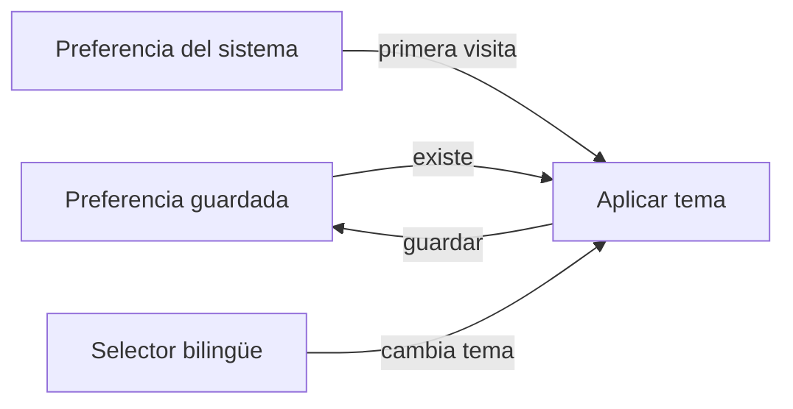

# Brief: Preferencia de tema claro/oscuro

## Requisito

Quien visita el portafolio en español o inglés puede alternar entre tema claro y oscuro. Antes de una elección propia, el sitio sigue la preferencia del sistema; después la recuerda en ese navegador.

## Supuestos

- La preferencia se comparte entre `/` y `/en/` porque ambas rutas pertenecen al mismo origen.
- El almacenamiento local es suficiente; no se necesita sincronización entre dispositivos.
- El modo actual seguirá siendo la presentación clara.

## Opciones

### Opción A — Sistema y elección guardada (aprobada)
- **Qué es:** usa `prefers-color-scheme` al entrar por primera vez, permite alternar manualmente y guarda esa elección en `localStorage`.
- **Pros:** respeta la preferencia existente y mantiene el control de la persona entre visitas.
- **Contras:** hay que aplicar el valor antes del primer pintado para evitar un cambio visual breve.

### Opción B — Claro por defecto y elección guardada
- **Qué es:** empieza en claro hasta que la persona elige otro tema; luego conserva su selección.
- **Pros:** presentación inicial idéntica en todos los dispositivos.
- **Contras:** ignora una preferencia oscura ya configurada en el sistema.

## Recomendación

Usar la opción A. Es la más adecuada para una preferencia visual personal, no requiere servicios ni paquetes nuevos y permite volver a la elección manual en ambas rutas. El usuario aprobó el alcance y el desarrollo con esa recomendación el 2026-11-19.

## Diagrama

## Decisiones

- Usar preferencia de sistema como valor inicial.
- Recordar el cambio manual con `localStorage` y compartirlo entre rutas de idioma.
- No sincronizar entre dispositivos ni añadir un servicio.

## Decision log / Agreements

| Decisión | Opción acordada | Motivo | Alternativa descartada | Fecha y confirmación |
| --- | --- | --- | --- | --- |
| Preferencia inicial y persistencia | Opción A — sistema y elección guardada | Respeta el sistema y conserva una elección manual sin servicios ni dependencias. | Opción B — iniciar siempre claro | 2026-11-19 · usuario: «se aprueba y se acepta alcance y desarrollo» |
