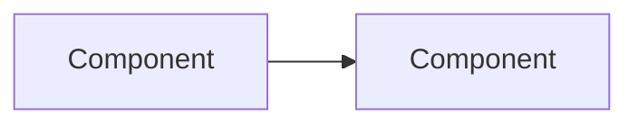

# Decision brief (I2)

Use when the request **creates architecture**, allows **multiple reasonable approaches**, or the human asks to see options before building.

**Location:** with the task — `specs/<000N…>/tasks/<task-id>/decision-brief.md`
(or an equivalent section in the intent). `specs/proposals/` at the root of `specs/` is **forbidden**.

It is not a product Spec, nor D-H, nor I3 plan/tasks. Showing it does not approve anything ([presentation-design](../rules/presentation-design.md)).

Fill in all sections. Do not leave template bracket placeholders. Keep option titles short; keep cells to one or two sentences.

## Front matter and body

```yaml
---
id: <task-id>-brief
title: <short title>
status: draft
task: specs/<000N…>/tasks/<task-id>/
updated: YYYY-MM-DD
---
```

```markdown
# Brief: <title>

## Requirement
<What was understood, in plain language. For whom and for what.>

## Assumptions
- <Assumption that the human can correct.>

## Options
### Option A — <short name>
- What it is: …
- Pros: …
- Cons: …

### Option B — <short name>
- What it is: …
- Pros: …
- Cons: …

## Recommendation
<Which option you recommend and why, in a few lines. Suitability analysis: lower technical debt, lower risk, or greater simplicity.>

## Diagram
(mermaid flowchart block with the nodes of *this* proposal; not the generic Client→API example)

## Decisions
- <Material choice for the human. Also open task questions. Write "None" if there are none.>

## Decision log / Agreements (evidence)
| Decision | Agreed option | Reason for recommendation | Discarded alternatives | Date and confirmation |
| --- | --- | --- | --- | --- |
| <Decision title> | <Option A/B> | <Why it was technically suitable> | <What was discarded and why> | <YYYY-MM-DD · confirmed by developer> |
```

Minimal diagram example (replace with the proposal's own):



## Short rules

1. 2 to 4 options with the **same** labels (`What it is`, `Pros`, `Cons`).
2. The diagram describes *this* proposal, not a generic example.
3. Every material decision must be resolvable before EXEC (or stop).
4. When presenting: options table + **reasoned recommendation** + diagram + questions; do not rewrite the brief in chat with new content.
5. After developer confirmation: record the agreed decision, its justification, and discarded alternatives in `Decision log / Agreements` as auditable task evidence.
